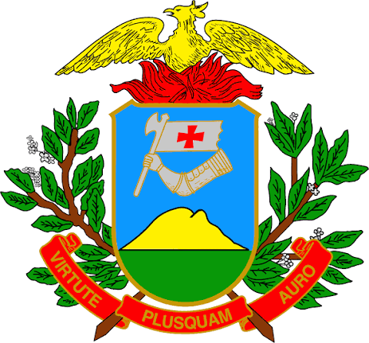

**GOVERNO DO ESTADO DE MATO GROSSO — CENTRAL DE ATENDIMENTO**

### Dados de referência
- **Protocolo:** 2024-000142
- **Data da solicitação:** 14/10/2026
- **Interessado(a):** MARCOS VINICIUS DE ALMEIDA SANTOS
- **Assunto:** Matrícula no curso Técnico em Enfermagem

### 1. Corpo da Comunicação

Prezado Senhor Marcos Vinicius de Almeida Santos,

Confirmamos o recebimento de sua solicitação, registrada sob o protocolo nº 2024-000142 na data de 14/10/2026, referente ao pedido de matrícula no curso Técnico em Enfermagem, turno noturno.

Informamos que o requerimento foi registrado no sistema e encaminhado para os procedimentos cabíveis. O andamento da solicitação segue os fluxos internos de tramitação do órgão.

### 2. Sinalização de Pendências e Dados Ausentes

- Documentos comprobatórios anexados: não localizado.
- A confirmação do pedido, bem como a verificação de eventuais requisitos específicos para o atendimento da solicitação, depende da análise do setor competente.

### 3. Fecho Institucional

Atenciosamente,

Mato Grosso, 14 de outubro de 2026.

__________________________________________________  
**Servidor Responsável**  
Central de Atendimento e Comunicação Institucional – GOV.MT

### Fontes consultadas
- `dados/originais/entrada_pdf-imagem.pdf`
